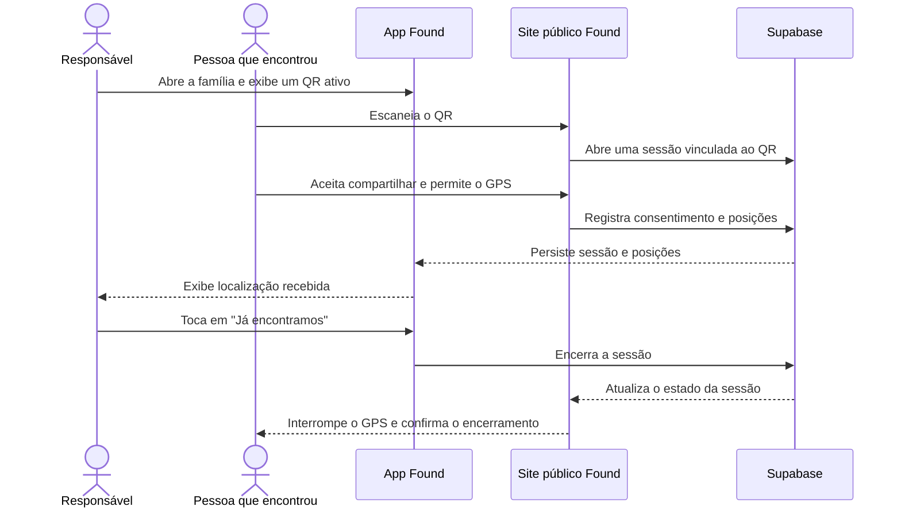

# Found

Aplicativo para ajudar famílias a receberem a localização de quem encontrou um QR Code associado a uma pessoa, pet ou objeto. O responsável acompanha a sessão no app; quem encontrou usa o navegador, autoriza o GPS e pode parar o compartilhamento quando quiser.

> **Em uma frase:** o Found transforma o QR Code em um canal de localização consentida entre quem encontra e a família.

## O problema e a proposta

Em locais movimentados, uma localização enviada só no momento em que o QR Code é escaneado pode ficar desatualizada enquanto a pessoa se desloca. O Found permite acompanhar as posições enviadas durante uma sessão ativa e encerrar o compartilhamento quando a família já encontrou o que procurava.

O QR Code pode ser impresso e colocado em uma etiqueta, pulseira ou outro item, sem depender de um dispositivo especial. Quem o encontra não precisa instalar o aplicativo nem criar uma conta.

## Como funciona



## O que o projeto implementa

- Cadastro e autenticação de responsáveis.
- Criação de famílias e gestão de participantes.
- Cadastro e ativação de QR Codes para uma família.
- Página web pública com consentimento explícito para compartilhar localização.
- Envio de posições GPS ao Supabase durante a sessão.
- Visualização da localização e do horário da posição no app.
- Atualização das posições e do estado da sessão.
- Encerramento pelo responsável (**Já encontramos**) ou por quem compartilha (**Parar de compartilhar**).
- Persistência no banco: ao reabrir a tela da família, o app consulta as sessões ativas e as posições existentes.

## Privacidade e acesso

- O site público não exige login e não mostra à pessoa que escaneou o nome da família ou da pessoa identificada pelo QR.
- A localização só começa depois que a pessoa escolhe compartilhar e concede a permissão de GPS.
- A pessoa pode parar o compartilhamento pelo site; o responsável pode encerrar a sessão pelo app.
- O acesso aos dados da família é controlado pelo Supabase e pelas políticas RLS. As operações públicas do navegador usam funções específicas do banco.
- O app e o site usam uma publishable key. Senhas do banco e chaves secretas não devem ser incluídas no código cliente.

## Organização do repositório

| Caminho | Conteúdo |
| --- | --- |
| [`app/`](./app) | Aplicativo Found: autenticação, famílias, QR Codes, sessões e mapa (Expo / React Native) |
| [`finder-site/`](./finder-site) | Site web aberto por quem escaneia o QR (React / Vite) |
| [`app/supabase/`](./app/supabase) | Migrations, tabelas, políticas de acesso e funções RPC (Supabase / PostgreSQL) |
| [`CONCEITO.md`](./CONCEITO.md) | Visão do produto, pesquisa de mercado, diferenciais e hipóteses para evolução |
| [`DESIGN.md`](./DESIGN.md) | Diretrizes visuais do app e do site |

## Executar localmente

O app e o site devem apontar para o mesmo projeto Supabase. Aplique as migrations da pasta `app/supabase/migrations/` em ordem.

### App Found

```bash
cd app
npm install
cp .env.example .env
npm run start
```

Configure no `app/.env`:

| Variável | Descrição |
| --- | --- |
| `EXPO_PUBLIC_SUPABASE_URL` | URL do projeto Supabase |
| `EXPO_PUBLIC_SUPABASE_PUBLISHABLE_KEY` | Publishable key do projeto |
| `EXPO_PUBLIC_PUBLIC_SITE_URL` | URL do site público que o QR deve abrir |

### Site público To Aqui

```bash
cd finder-site
npm install
cp .env.example .env
npm run dev
```

Configure `VITE_SUPABASE_URL` e `VITE_SUPABASE_PUBLISHABLE_KEY` no `finder-site/.env`. Em produção, publique o site em HTTPS para permitir o uso do GPS em celulares e atualize `EXPO_PUBLIC_PUBLIC_SITE_URL` no app.

## Preparar uma demonstração

Para mostrar o fluxo real entre os componentes:

1. Abra o Found com uma conta de responsável e selecione uma família de demonstração.
2. Na área de QR Codes, deixe aberto um código ativo.
3. Escaneie o QR em outro celular ou navegador. Aceite o consentimento e a permissão de localização.
4. Mostre a posição recebida no app e, se possível, a página web ao mesmo tempo.
5. Reabra a tela da família para mostrar que a sessão e as posições vêm do banco.
6. Toque em **Já encontramos** no app e mostre a confirmação de encerramento no site.

Use uma família de demonstração e evite expor dados pessoais na gravação. Para funcionamento em um segundo celular, o site precisa estar publicado em HTTPS; os dois clientes devem usar o mesmo projeto Supabase.

## Relação com o documento de conceito

O [`CONCEITO.md`](./CONCEITO.md) apresenta a motivação, o diferencial esperado de acompanhamento contínuo e possibilidades de evolução. Ele também lista ideias que devem ser apresentadas como **visão ou trabalho futuro**, caso ainda não apareçam na demonstração, por exemplo: fallback por SMS, ponto de encontro, modo evento, Wake Lock e rede colaborativa. Este README descreve o que está implementado no repositório hoje.

## Comandos úteis

| Projeto | Desenvolvimento | Verificação / build |
| --- | --- | --- |
| `app/` | `npm run start` | `npx tsc --noEmit` · `npm run lint` |
| `finder-site/` | `npm run dev` | `npm run build` |

Para o passo a passo específico, consulte o [README do app](./app/README.md) e o [README do site](./finder-site/README.md).
